# 搞机工坊 · DroidForge

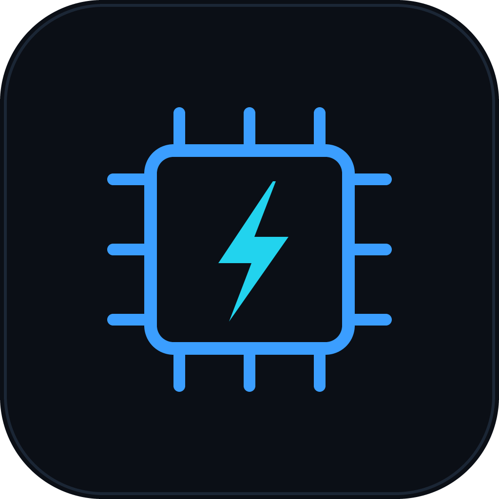

一个开源、跨平台的 Android 搞机工具箱。把散落在命令行里的 `adb` / `fastboot` 操作、刷机包解析、
Root 补丁流程收进一个界面里，专治「记不住命令、找不到分区、刷完变砖」。

Windows / macOS / Linux 通用，单文件可执行，**所有命令都在本机执行，不上传任何设备数据**。

[](LICENSE)
[](https://github.com/qingxinhou/droidforge/releases/latest)
[](https://github.com/qingxinhou/droidforge/actions/workflows/build.yml)
[](https://go.dev)
[](https://wails.io)

---

## 功能

| 模块 | 能力 |
| --- | --- |
| **设备管理** | USB / 无线设备自动发现、一键切换 ADB / Fastboot、设备信息总览（型号、SoC、内核、槽位、动态分区、BL 状态、Root 方案） |
| **ADB 终端** | 内置 Shell，支持命令历史（↑↓）、快捷命令、输出复制，等同于 `adb -s <serial> shell` |
| **重启控制** | 系统 / Recovery / Bootloader / fastbootd / EDL(9008) / Sideload / 关机 |
| **刷入镜像** | 单分区刷入，自动识别 boot / init_boot / vendor_boot，A/B 槽位选择，sparse → raw 转换。设备在 bootloader / fastbootd 时自动改从 `fastboot getvar all` 读分区表（此时 `adb` 完全不可见） |
| **线刷整包** | 扫描镜像目录自动生成刷机顺序，动态分区自动切 fastbootd，支持按分区勾选 |
| **刷机包提取** | OTA zip（payload.bin）、小米 tgz、三星 tar.md5、镜像文件夹；按分区按需提取，无需解压整包 |
| **超级分区** | 解析 `super.img` 的 `lp_metadata`，列出全部逻辑分区并按需导出；把散包分区按 `super_def` 分组合成 `super.img`（含双槽位 metadata 与备份） |
| **线刷脚本** | 由镜像目录生成 `flash-all.bat` / `.sh` / `.txt`，自动处理 fastbootd 切换、槽位后缀与逐步错误中断 |
| **固件下载** | OTA / 线刷包直链多线程分段下载，断点续传（`.dpart` 状态文件），链接过期给出可读提示 |
| **引导校验** | 解析 vbmeta 的签名算法、`rollback_index`、flags 与全部描述符（hash / hashtree / chain / kernel cmdline / property）；带 `AVBf` footer 的 boot / system 镜像会自动定位 vbmeta 位置 |
| **ARB 熔断检测** | 扫描引导镜像（xbl / abl / emmc_appsboot）里的 anti-rollback 标记，给出候选版本与置信度；配合两侧版本对比，判断降级是否会触发熔断 |
| **OTA 直链提取** | 直接粘贴 full OTA 下载链接，用 HTTP Range 远程定位 `payload.bin`，只下载选中分区真正用到的字节；支持自定义 UA / Referer，也可整包下载 |
| **一键 Root** | KernelSU / KernelSU Next / Magisk 官方 / Magisk Alpha（阿尔法面具）/ Magisk Delta（德尔塔面具）/ APatch |
| **模块管理** | 批量安装 Magisk / KernelSU / APatch 模块：解析 `module.prop`、自动识别 root 方案并选择对应安装命令、逐个推送安装并清理临时文件 |
| **EDL 9008** | Sahara 握手 + Firehose 会话：加载 loader、读 GPT 分区表（多 LUN）、按分区读取 / 写入 / 擦除、发送重启。传输层为 Windows WinUSB（SetupAPI + `winusb.dll`，无 cgo） |
| **分区管理** | 分区表查看、块设备映射、容量、挂载点，导出分区镜像。**无 root 时容量普遍读不到**（Android 10+ 封了 `/proc/partitions` 与 sysfs），进 fastbootd 可一次拿到全部分区的真实容量 |
| **投屏** | 调用本机 scrcpy 开独立窗口，可调码率 / 长边 / 帧率，支持关屏投屏、常亮、静音转发、窗口置顶与同时录制 |
| **备份助手** | 照片、文档、音乐按类别用 `tar` 流批量拉取（比逐个 `adb pull` 快一个量级，设备端 base64 编码后传输），通讯录与短信导出为带 BOM 的 CSV；已存在且大小一致的文件自动跳过。**通讯录 / 短信在 Android 11+ 上被 provider 权限拦住，无 root 时会明确提示不可用** |
| **应用管理** | 启用 / 禁用、运行、强行停止、清除数据、保留数据卸载、恢复系统应用、提取安装包（含 split）、Google 套件批量管理、操作记录 |
| **文件传输** | 单个 / 批量 / 拆分 APK 安装（`install-multiple`）、推送文件、按路径拉取、按包名提取安装包 |
| **显示控制** | 分辨率、显示密度（DPI）、字体缩放、窗口 / 过渡 / 动画倍率、自动锁屏、按键与文本输入、截图 |
| **系统界面** | 状态栏图标隐藏、时钟显秒、电量百分比、快捷开关数量、全局沉浸模式、关闭 Wi-Fi 网络检测 |
| **电池管理** | 实时电压 / 电流 / 功率 / 温度、定时采样与曲线、CSV 导出、电池参数模拟与恢复 |
| **性能监控** | 各核心实时频率、大小簇分组、调频策略（governor）、可调刷新间隔 |
| **控机脚本** | BAT 语法子集（echo / set / if / for / goto / timeout），脚本内 `adb` 指令真实下发，支持导入导出 |
| **界面设置** | 深色 / 浅色 / 跟随系统三档主题（默认跟随系统）、默认启动页、界面缩放、隐藏设备标识、CPU 刷新间隔、目录偏好、配置导入导出 |
| **导航与检索** | 按「操作性质与风险」分四组：设备 / 调校 / 刷机 / 进阶；Ctrl / Cmd + K 命令面板可直接检索全部功能（支持英文别名） |
| **辅助** | 无线调试、boot 镜像解析与拆分、payload 清单解析、镜像类型识别、日志导出 |

---

## 界面预览

> 截图使用内置的演示数据渲染，不涉及任何真实设备信息。

<table>
<tr>
<td width="50%">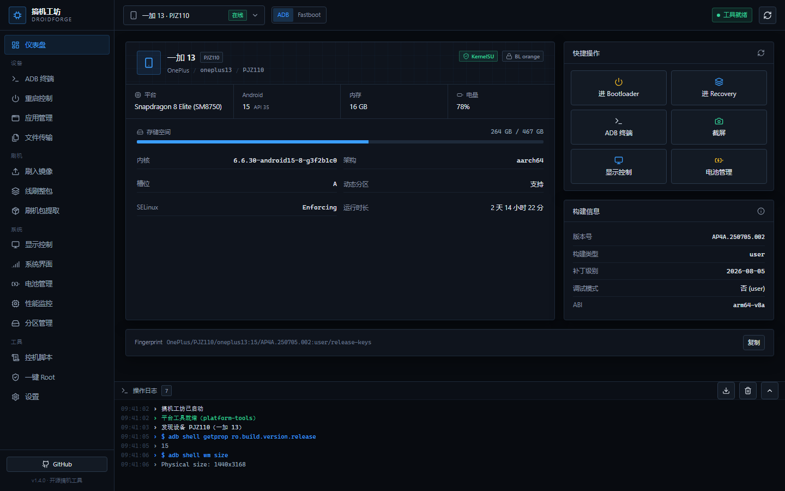<br /><sub><b>设备总览</b> · 型号 / SoC / 内核 / 槽位 / 动态分区 / BL 状态 / Root 方案一屏看完</sub></td>
<td width="50%">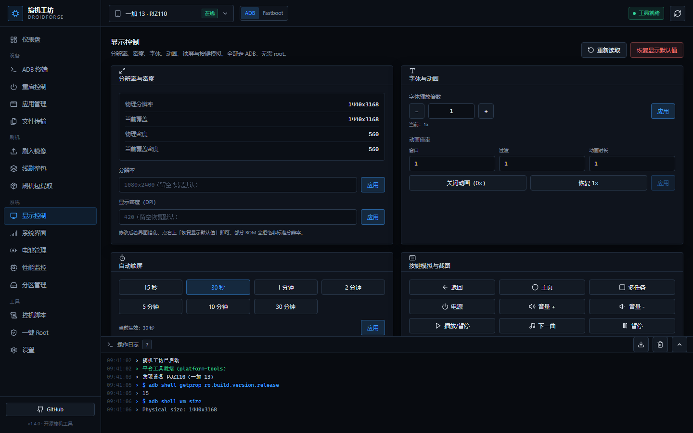<br /><sub><b>显示控制</b> · 分辨率、DPI、字体缩放、动画倍率，随时可恢复默认</sub></td>
</tr>
<tr>
<td>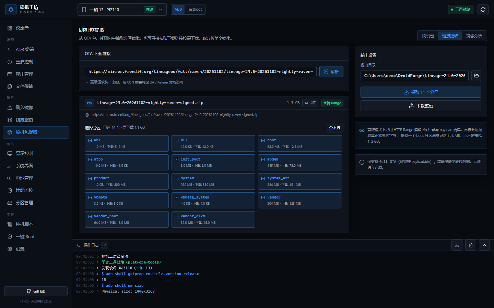<br /><sub><b>OTA 直链提取</b> · 粘贴链接即可按分区取镜像，每个分区同时给出「实际大小 / 需要下载」，1.3 GB 的包里取 <code>dtbo</code> 只需 41 KB</sub></td>
<td>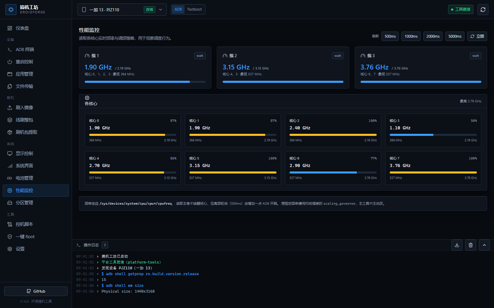<br /><sub><b>性能监控</b> · 各核心实时频率、大小簇分组、调频策略</sub></td>
</tr>
<tr>
<td>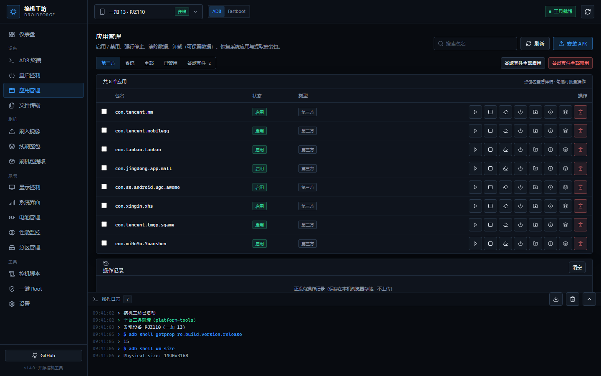<br /><sub><b>应用管理</b> · 五类筛选、批量启停、提取安装包、本地操作记录</sub></td>
<td>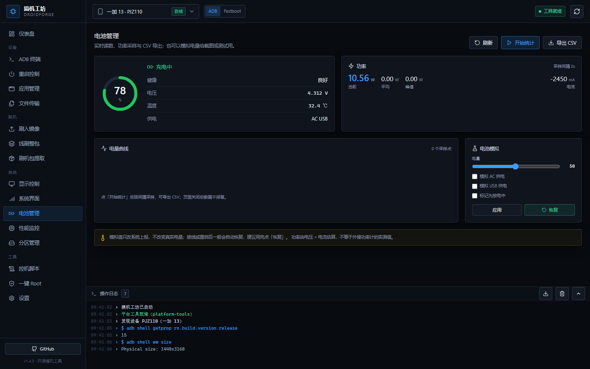<br /><sub><b>电池管理</b> · 功率 / 温度曲线、CSV 导出、电池参数模拟</sub></td>
</tr>
<tr>
<td>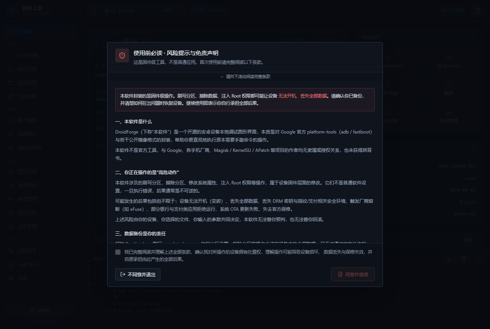<br /><sub><b>首次启动的协议门</b> · 必须读完并勾选才能进入，也可直接拒绝并退出</sub></td>
<td>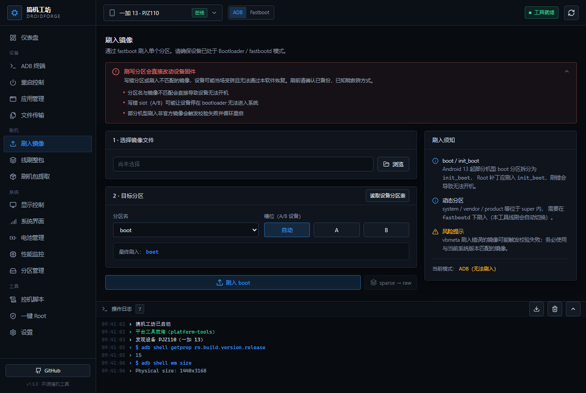<br /><sub><b>页面级风险横幅</b> · 刷机 / Root / 脚本页顶部常驻，写清该页面独有的失败模式</sub></td>
</tr>
<tr>
<td>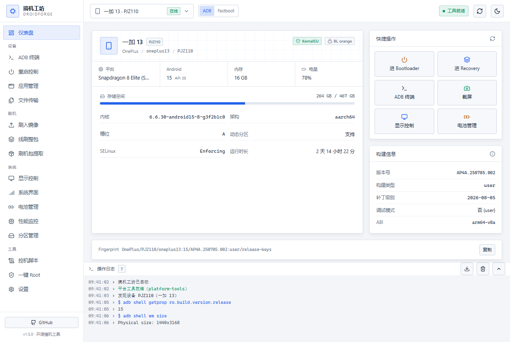<br /><sub><b>浅色主题</b> · 默认跟随系统外观，顶栏一键切换；全部组件随 CSS 变量整体换色</sub></td>
<td>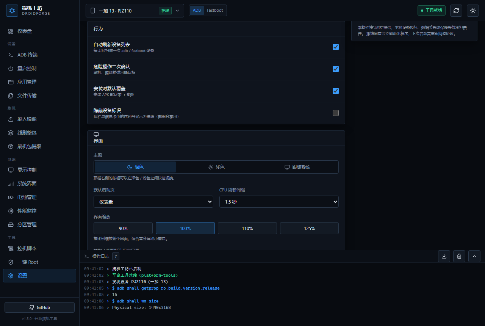<br /><sub><b>主题设置</b> · 深色 / 浅色 / 跟随系统，选择即时生效并写入配置</sub></td>
</tr>
<tr>
<td>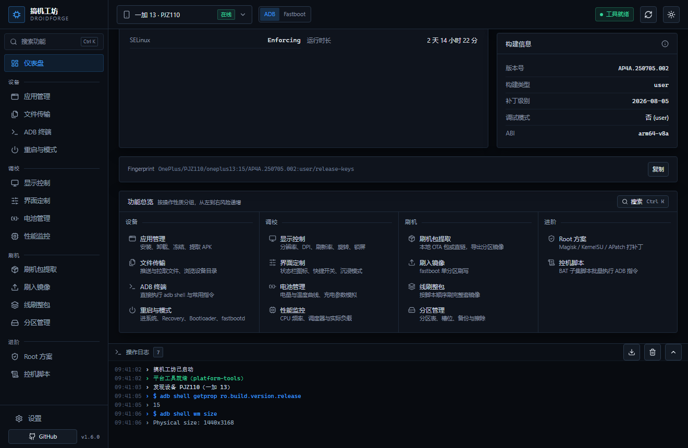<br /><sub><b>重新分组的功能总览</b> · 设备 / 调校 / 刷机 / 进阶，从左到右风险递增</sub></td>
<td>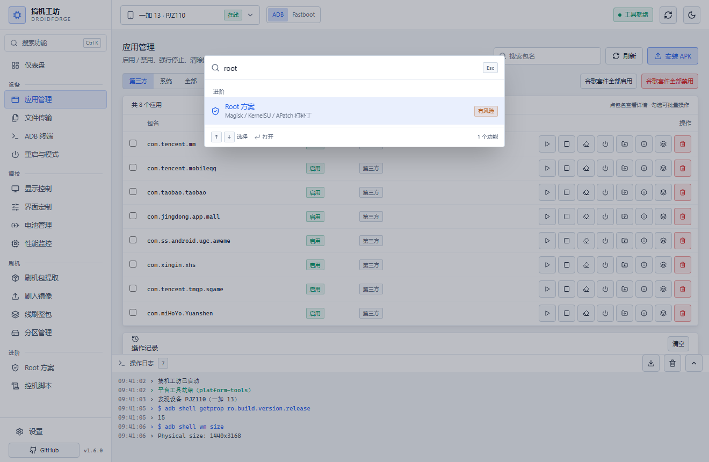<br /><sub><b>命令面板</b> · Ctrl K 检索全部功能，标注所需设备状态与风险</sub></td>
</tr>
</table>

界面为**单窗口 + 左侧分组导航 + 底部常驻日志控制台**，所有命令与输出都实时可见，
出问题时可以直接「导出日志」贴到 Issue 里。

---

## 下载

前往 [Releases](https://github.com/qingxinhou/droidforge/releases/latest) 获取对应平台的构建产物：

- `DroidForge-windows-amd64.zip`
- `DroidForge-macos-universal.zip`
- `DroidForge-linux-amd64.tar.gz`

> 首次启动若提示缺少平台工具，进入「设置 → 平台工具 → 下载官方 platform-tools」即可，
> 也可以把 `platform-tools` 文件夹放到程序同目录，实现绿色免配置。

### Windows 上被杀软拦截 / SmartScreen 拦截

这是**预期内的**，原因有三个，都与代码无关：

1. 可执行文件**未做代码签名**（个人开发者签名证书约 300–500 美元/年，本项目暂无预算）；
2. 程序会创建子进程调用 `adb.exe` / `fastboot.exe` 并读写磁盘，这是杀软启发式规则的高危特征；
3. 「刷机 / Root / 分区」这类关键词本身就容易触发误判。

处理方式：

- **SmartScreen**：点「更多信息」→「仍要运行」。
- **杀软误报**：把程序目录加入白名单，或将误报样本提交给厂商（火绒 / 360 / Defender 均有误报反馈入口）。
- **想完全自证清白**：按下方「从源码构建」自己编译，代码全部开源，无任何联网上报逻辑。

> 从源码自行构建得到的 exe 通常不会被拦截，因为缺少厂商的「信誉积累」才是触发的根因。

### 使用前提

1. 手机开启「开发者选项 → USB 调试」，并在弹窗中允许本机调试；
2. 刷机、Root 等功能需要 Bootloader 已解锁。**解锁请通过厂商官方渠道自行完成**——本工具不提供解锁功能，也不包含任何漏洞利用或绕过安全机制的实现；
3. Windows 需要 WebView2（Win10/11 一般已内置）。

---

## 从源码构建

```bash
# 依赖：Go 1.23+、Node 18+、Wails CLI
go install github.com/wailsapp/wails/v2/cmd/wails@v2.12.0

git clone https://github.com/<your-name>/droidforge.git
cd droidforge
wails build            # 产物在 build/bin/
```

开发模式（前端热重载）：

```bash
wails dev
```

Linux 额外依赖：

```bash
sudo apt install libgtk-3-dev libwebkit2gtk-4.0-dev
```

---

## 项目结构

```
.
├── main.go                  # 应用入口与窗口配置
├── app.go                   # App 结构、启动/关闭、日志与进度事件、状态访问器
├── bind_device.go           # 绑定：环境探测、设备信息、分区表
├── bind_adb.go              # 绑定：shell、重启、push/pull、安装、应用、截屏、无线调试
├── bind_flash.go            # 绑定：fastboot 刷入、擦除、槽位、线刷刷机计划
├── bind_image.go            # 绑定：boot / payload / sparse 镜像解析
├── bind_ota.go              # 绑定：远程 OTA 直链解析与提取
├── bind_super.go            # 绑定：super 解析/拆分/合成、线刷脚本生成
├── bind_download.go         # 绑定：直链探测与多线程断点续传
├── bind_root.go             # 绑定：Root 方案与补丁编排
├── bind_util.go             # 绑定：文件对话框、剪贴板、外部打开
├── bind_config.go           # 绑定：配置读写
├── app_extras.go            # 绑定：系统调校、电池、CPU、脚本、应用详情
├── internal/
│   ├── adb/                 # adb 命令封装（设备、shell、文件、应用启停与详情）
│   ├── fastboot/            # fastboot 命令封装（刷入、擦除、变量读取）
│   ├── device/              # 设备信息采集、分区表、Root 检测
│   ├── image/               # boot.img / payload.bin / sparse 解析
│   ├── lp/                  # lp_metadata 解析与生成、super 拆分合成、sparse 读取器
│   ├── download/            # 多线程分段下载与断点续传
│   ├── flashscript/         # 线刷脚本（bat / sh / txt）渲染
│   ├── remote/              # 远程 OTA：HTTP Range、远程 zip 目录、直链提取
│   ├── rom/                 # 刷机包识别、解包、线刷计划生成
│   ├── root/                # Root 方案、补丁工具下载与编排
│   ├── session/             # 运行时状态：配置快照与长任务取消登记（并发安全）
│   ├── tweaks/              # 分辨率 / 密度 / 字体 / 动画 / 状态栏设置
│   ├── power/               # 电池读数与参数模拟
│   ├── cpu/                 # 各核心频率与调频簇
│   ├── script/              # BAT 子集解释器
│   ├── platform/            # 工具链定位、platform-tools 下载
│   ├── runner/              # 子进程执行与流式日志
│   └── store/               # 配置持久化
├── frontend/                # Vue 3 + TypeScript + Vite + Tailwind
│   └── src/
│       ├── views/           # 16 个功能页面
│       ├── components/      # 侧边栏、顶栏、日志控制台、确认框
│       ├── api.ts           # 对 Wails 绑定的类型化封装
│       └── store.ts         # 全局状态与设备选择
└── tools/
    ├── icongen/             # 应用图标生成器（可选）
    └── remotecheck/         # 远程 OTA 解析联调小工具（可选）
```

---

## 实现说明

### Root 补丁为什么要在手机上执行？

Magisk 的 `magiskboot`、KernelSU 的 `ksud`、APatch 的 `apd` 本质上都是 **Android ARM 二进制**，
在 Windows / macOS 上无法直接运行，也不该要求用户装 WSL 或交叉编译环境。因此流程设计为：

```
下载官方 APK → 解出 ARM 工具 → push 到 /data/local/tmp/droidforge
            → 在手机上执行补丁 → pull 回补丁镜像 → fastboot 刷入
```

好处是三端行为完全一致，且永远使用官方最新的补丁脚本。

### payload.bin 解析

内置了一个极简的 protobuf wire 解码器，直接读取 `payload.bin` 的 `DeltaArchiveManifest`，
支持 `REPLACE` / `REPLACE_BZ` / `REPLACE_XZ` / `ZERO` / `DISCARD` 操作，
按 `dst_extents` 把数据流分散写入目标分区（一条操作可以跨多个 extent）。
提取时只读需要的分区数据，不落地整个 payload。

字段号以 AOSP `update_metadata.proto` 为准：`PartitionUpdate` 的 `new_partition_info = 7`、
`operations = 8`，`DeltaArchiveManifest.partitions = 13`。

### 远程 OTA 直链是怎么做到只下十几 MB 的

不需要把 1–2 GB 的整包拉到本地，全靠 HTTP `Range` 逐步定位：

```
① Range: bytes=0-0                      → 拿到文件总长度与 Content-Disposition 里的文件名
② 读末尾 64KB                            → 找到 zip 的 EOCD（含 ZIP64 兼容）
③ 读中央目录                             → 找到 payload.bin 条目与它的本地头偏移
④ 读本地文件头                           → 算出 payload.bin 数据区的绝对偏移
⑤ 读 24 字节 + manifest                  → 解析出每个分区的 operations / data_offset / data_length
⑥ 只对选中分区的 data 区间发 Range 请求    → 边下载边解压，直接写进 .img 的对应 extent
```

一个 1.34 GB 的 LineageOS 整包里，`dtbo`（16 MB）实际只需下载约 40 KB，
`boot`（64 MB）约 13 MB。服务端不支持 `Range` 时（常见于重定向到镜像站之后），
界面会提示改用「下载整包」，不会静默失败。

实现上把「数据从哪来」抽象成 `SegmentOpener(offset, length)`，
本地文件用 `io.SectionReader`，远程用分块 Range 读取器，**两端共用同一套解压与写入逻辑**。

### 动态分区

`system` / `vendor` / `product` 等位于 `super` 内，普通 fastboot 无法直接写入。
线刷流程会自动把这类分区排到后面，先执行 `fastboot reboot fastboot` 进入 fastbootd 再刷。

### 并发模型

Wails 的每个绑定方法都可能落在不同 goroutine 上，子进程的输出回调也在独立 goroutine 里执行。
因此配置（`store.Config`）、工具链探测结果（`platform.Tools`）和「当前长任务的 cancel」这三样
可变状态全部收敛到 `internal/session`：

- `session.State` —— 带 `RWMutex`，`Config()` / `Tools()` 返回**副本**，外部拿到后随便读都不会串；
- `session.Ops` —— 用自增序号标记任务代际。新任务接管时取消上一个，而每个任务收尾时只在
  **自己仍是当前任务**的情况下才清空登记，避免先结束的旧任务把后启动的新任务抹掉。

这块之所以单独成包，是为了能在没有 GUI、没有 cgo 的环境里用 `-race` 做回归测试
（见 `internal/session/session_test.go`）。CI 里 `go test -race -count=2 ./internal/...` 是必过项。

---

## 已知限制

- **增量 OTA 不支持**：`SOURCE_COPY` / `SOURCE_BSDIFF` 等操作需要原厂底包才能还原，请在提取时使用完整 OTA 包。
- **远程直提要求服务端支持 Range**：部分 OTA 链接会 302 到不支持分段请求的镜像，此时只能用「下载整包」。
- **super 拆分只处理单块设备**：虚拟 A/B 的 `_b` 槽位若落在另一块块设备上，拆分时会明确报错而不是输出错误内容。
- **super 合成不生成 `super_empty.img`**：输出的是带数据与完整 metadata 的完整镜像，用 `fastboot flash super` 刷入；需要 `wipe-super` 流程的场景请用原厂空镜像。
- **合成结果不保证适配机型**：分区名、槽位与组容量必须与目标设备一致，工具只保证 metadata 结构合法。
- **Magisk 分支的补丁脚本存在版本差异**：若自动下载的版本补丁失败，可在 Root 页指定本地 APK。
- **系统调校依赖 ROM**：分辨率 / 密度 / 状态栏图标等写入的是系统设置，部分厂商 ROM 会拒绝或覆盖，属正常现象。
- **电池模拟只改上报值**：不改变真实电量，重启或拔插电源后一般会恢复，建议用完点「恢复」。
- **CPU 频率依赖内核节点**：部分设备不开放 `cpufreq`，此时性能页无法读数。
- **分区容量在系统内普遍读不到**：Android 10+ 把 `/proc/partitions`、`/sys/class/block/*/size`、
  `blockdev --getsize64` 对 `shell` 用户全部封死（实测 Redmi K60 至尊版 / Android 13 全为
  `Permission denied`）。系统内只有 `df` 覆盖的已挂载分区有真实容量，其余显示「—」；
  想看完整容量请把设备切到 fastbootd，此时 `fastboot getvar all` 会给出全部分区的实际大小。
- **bootloader 下只可见物理分区**：内核态 fastboot 的 `getvar all` 只有 `boot` / `dtbo` / `super`
  这类物理分区；`system` / `vendor` 等 `super` 子分区要进 fastbootd（`is-userspace: yes`）才列得出来。
- **fastboot 变量格式随模式变化**：bootloader 输出 `key: value` 且容量是裸十六进制（`4000000`），
  fastbootd 输出 `key:value` 且容量带 `0x` 前缀（`0x4000000`），两种都已适配。
  另外「变量不存在」在 bootloader 上是「键回显、值为空、退出码 0」，不是报错。
- **脚本只支持 BAT 子集**：不支持 `for /f`、管道、重定向、`call` 与外部程序，详见页面内「语法范围」。
- **EDL 直连仅支持 Windows**：传输层基于 WinUSB，其他平台会明确提示不支持。
- **EDL 需要先换驱动**：Windows 上 9008 默认挂 QDLoader 串口驱动，需用 Zadig 换成 WinUSB 后本工具才能访问；换驱动后 QDLoader 官方工具会暂时不可用。
- **EDL 需要用户自备 loader**：本工具不提供、不下载 `prog_firehose_*.elf`。loader 与机型不匹配时写入会失败，甚至让设备停在 9008。
- **ARB 检测是启发式的**：ARB 没有跨厂商统一格式，扫描结果只作参考；确定性的判断请用 vbmeta 里的 `rollback_index`。
- **不支持 OPS 包**：OPS 是 OPPO 早期私有格式，没有公开规范，强行解析只会给出错误结果，因此明确拒绝。
- **投屏不内嵌画面**：scrcpy 自己开原生窗口，本工具只负责参数与进程管理，不做视频解码内嵌。
- **备份不含应用数据**：`/sdcard/Android/data` 在 Android 11 以上普遍不可读，应用私有数据不在备份范围内。
- **通讯录 / 短信导出需要 root**：Android 11+ 收紧了 provider 权限，`adb shell` 访问 `content://com.android.contacts`
  会直接抛 `SecurityException`（缺 `READ_CONTACTS`）。这是系统限制，工具不会绕过；无 root 时该类别会显示为不可用。
- **分区容量多半读不到**：Android 10+ 起 `shell` 用户读 `/proc/partitions`、`/sys/class/block/*/size` 与
  `blockdev` 全部被 SELinux 拒绝。工具会用 `df` 补上已挂载分区的容量，其余如实标为未知，不猜也不填 0。
- **实时电流需要 root**：`/sys/class/power_supply/*/current_now` 同样被拒，此时电池页显示——而不是 0 mA，
  电压、温度、电量仍然准确。
- 刷机相关的最终确认动作仍需要用户在手机上完成（这是厂商的安全设计，工具不会绕过）。

## 不做的事

为避免误解，这里明确列出本工具**不会**实现的能力：

- **不提供 Bootloader 解锁**：没有 `fastboot flashing unlock` 一键按钮，没有解锁状态改写，也不附带任何解锁指引。解锁请走厂商官方渠道。
- **不绕过厂商授权**：EDL 只实现公开协议的读写流程，不提供、不分发 loader 与固件；对需要签名 loader 或授权账号的机型，写入会被设备拒绝，工具不会尝试绕过。
- **不做熔断绕过**：ARB 只做只读分析与对比，不提供改写熔断计数或回滚 `rollback_index` 的能力。
- **不包含漏洞利用**：不涉及 SoC 提权漏洞链、efisp / abl 改写等。
- **不附带第三方签名载荷**：不内置、不分发任何 loader、firehose 或分区镜像。EDL 用的 loader 必须由用户自己提供。
- **不做免解锁 Root**：Root 流程假设设备已由用户自行解锁。

---

## 致谢

- [rcmiku/Payload-Dumper-Compose](https://github.com/rcmiku/Payload-Dumper-Compose) — 「从 full OTA URL 直接 dump 分区」的实现思路来源（HTTP Range + 远程 zip 中央目录 + 远程 payload 清单），本项目的远程提取能力是按其思路用 Go 重写并接入的。
- [5ec1cff/payload-dumper](https://github.com/5ec1cff/payload-dumper) — payload 解析的参考实现。
- [Wails](https://wails.io)、[Vue](https://vuejs.org)、[Lucide](https://lucide.dev)、[ulikunitz/xz](https://github.com/ulikunitz/xz)。
- [CzJam/gjgjxweb](https://github.com/CzJam/gjgjxweb)（晨钟酱《搞机工具箱》）— 应用管理、显示控制、电池管理、控机脚本等功能的**设计参考**。该项目为 GPL-3.0，本项目与其**没有任何代码复用**，功能均为按 ADB 行为独立实现；如需引用其代码，请遵守 GPL-3.0。
- [Smart-Paocai/VioletToolBox](https://github.com/Smart-Paocai/VioletToolBox)（紫罗兰工具箱）— super 分区拆合、线刷脚本、多线程下载等功能的**需求与交互参考**。该项目为 C# / GPL-3.0，与本项目语言不同且**没有任何代码复用**：`lp_metadata` 结构按 AOSP `liblp` 的 `metadata_format.h` 独立实现，下载、脚本渲染、AVB 解析、Sahara / Firehose 会话均为按公开规范自行设计与实现。EDL 的协议细节参考了高通公开的 `sahara_protocol.h` 与 `firehose` 文档，以及 [bkerler/edl](https://github.com/bkerler/edl) 对报文时序的说明。

---

## 风险提示与免责声明

> **软件内有一道强制的协议门**：首次启动会全屏显示完整条款，必须滚动到底部并勾选确认才能进入。
> 条款内容变更后版本号递增，会重新提示。可在「设置 → 风险与合规」中随时重读，或撤销同意（撤销后立即退出程序）。

### 这是固件级工具，不是普通应用

本工具封装的是 `adb` / `fastboot` 的写操作。刷写分区、擦除数据、修改系统属性、注入 Root 权限，
作用对象是设备的启动链与系统分区，**不是可撤销的软件设置**。

### 明确不由本项目承担的后果

| 后果 | 说明 |
| --- | --- |
| 设备无法开机（变砖） | 分区名与镜像不匹配、写错 slot、固件与机型/区域不符 |
| 数据全部丢失 | 解锁、刷写 `userdata` / `super`、恢复出厂设置均不可逆 |
| 保修失效 | 多数厂商在解锁 Bootloader 时即终止保修，部分机型有不可逆熔断 |
| 安全环境破坏 | 支付、银行、企业办公、部分游戏反作弊可能拒绝运行 |
| OTA 更新失败 | 修改过 `boot` / `vbmeta` 后，官方增量更新通常会校验失败 |
| 第三方组件的任何问题 | Root 方案安装包、厂商固件、你自己选的镜像，均由提供方负责 |

**本软件无法替你预判风险，也无法替你回滚。** 执行写操作前请自行完成数据备份，
并确认你握有救砖手段（官方线刷包、厂商救援工具或售后渠道）。

### 合法用途

只能对**你自己拥有**或**已获所有者明确授权**的设备使用。
严禁用于破解、监控或控制他人设备，绕过他人设备的安全机制，规避付费内容，窃取数据或侵犯隐私。

### 无担保与责任限制

本软件按 **"现状"（AS IS）** 提供，不附带任何明示或默示担保，包括对适销性、特定用途适用性、
无缺陷、不侵权的担保。

在适用法律允许的最大范围内，作者与贡献者不对你因使用或无法使用本软件而产生的任何直接、间接、
偶然、特殊、惩罚性或后果性损失承担责任，包括但不限于设备损坏、数据丢失、利润损失、业务中断、
维修或替换成本。即使作者已被告知上述损害的可能性，本条款依然有效。

### 本软件的边界

本软件**不**提供 Bootloader 解锁能力，**不**包含任何漏洞利用代码，**不**附带第三方签名载荷，
**不**提供免解锁 Root 方案。任何声称由本项目完成上述操作的教程均与本项目无关；
被第三方篡改的副本，其行为亦与本项目无关 —— 请仅从本仓库的 Releases 下载。

---

## 贡献

欢迎 Issue 与 PR。提交前请确保以下命令全部通过（CI 会逐条执行）：

```bash
gofmt -l .                       # 应为空
go vet ./...
go test ./...
go test -race ./internal/...     # 并发契约，需要 cgo（Windows 请装 MinGW）
cd frontend && npm run typecheck && npm run build
```

- 新增 Root 方案：改 `internal/root/root.go` 的 `Solutions()`，并在 `patchCommand` 里补对应命令；
- 新增刷机包格式：改 `internal/rom/rom.go` 的识别与解包分支；
- 新增系统调校项：改 `internal/tweaks`，前端在 `views/DisplayControl.vue` / `SystemUi.vue` 接入；
- **涉及设备写操作的改动，请一并补测试**——`internal/root` 里的假 APK 构造可以照抄。

---

## License

[MIT](LICENSE) © 2026 DroidForge Contributors

---

## English

**DroidForge** is an open-source, cross-platform desktop toolkit for Android power users.
It wraps `adb` and `fastboot` into a single GUI: device overview, shell terminal, reboot targets,
single-partition flashing, full-image flashing, OTA/ROM extraction (including `payload.bin`),
extracting partitions **directly from a full OTA download URL** via HTTP Range requests,
one-click root patching (KernelSU / Magisk / Magisk Alpha / Magisk Delta / APatch),
on-device tuning (resolution / DPI / font scale / animation scales / status-bar icons),
battery monitoring with CSV export and state mocking, per-core CPU frequency,
app enable / disable / data management, partition browsing, file transfer,
and a BAT-subset script runner.
It deliberately does **not** provide bootloader unlocking or any exploit-based bypass.

Built with Go + Wails v2 and Vue 3 + TypeScript. Everything runs locally — no telemetry, no uploads.
Ships with dark, light and follow-system themes, switchable from the top bar.

> **UI language:** the interface is currently **Simplified Chinese only**. An i18n layer is on the
> roadmap; until then this English section describes the feature set rather than the UI text.

### Risk notice & disclaimer

This is a **firmware-level** tool. Flashing partitions, erasing data and injecting root modify the
boot chain — mistakes are not reversible from inside the app.

On first launch the app shows a **mandatory disclaimer** that must be scrolled to the end and
explicitly accepted; declining quits the application. Destructive actions additionally require
ticking a risk acknowledgement before the confirm button unlocks.

You may **lose your data**, **brick your device**, or **void your warranty**. Use it only on devices
you own or are authorized to service, never to tamper with someone else's device, bypass security
controls, or infringe anyone's privacy.

The software is provided **“AS IS”**, without warranty of any kind. To the maximum extent permitted
by law, the authors and contributors are **not liable** for any direct, indirect, incidental,
special, punitive or consequential damages — including device damage, data loss, loss of profits or
business interruption — arising from the use of, or inability to use, this software.

```bash
wails build
```
